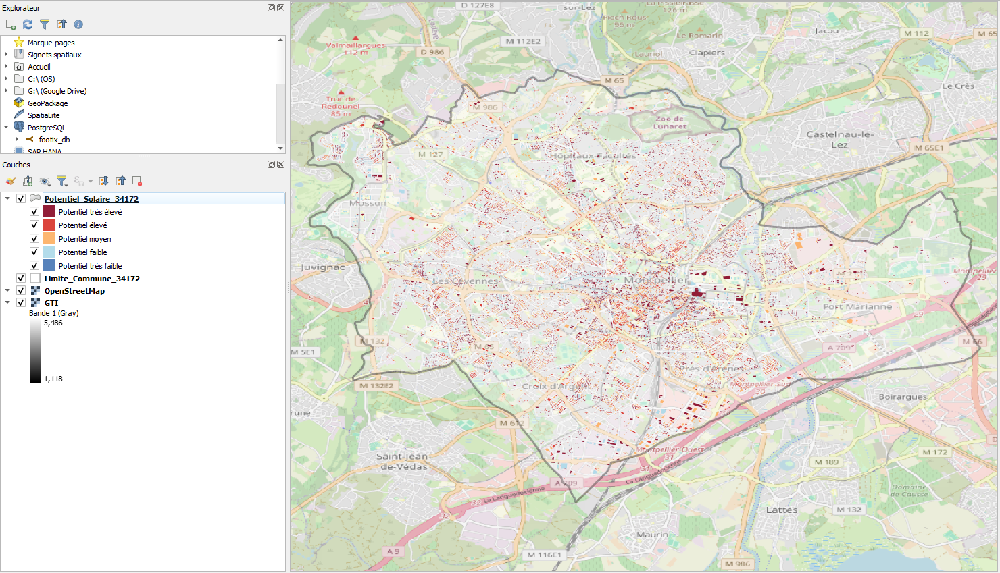

# RoofSun

Plugin QGIS qui classe les toitures d'une commune, d'un arrondissement ou d'un IRIS selon leur potentiel solaire pour le photovoltaïque, en cinq niveaux allant de « Très élevé » à « Très faible ».

## Ce que fait le plugin

On choisit la zone dans des listes en cascade (région, département, EPCI, commune, puis IRIS ou arrondissement) et un raster d'irradiance déjà chargé dans le projet. Le plugin télécharge alors les bâtiments de la BD TOPO sur l'emprise de la zone, lance le modèle de calcul et ajoute au projet la couche classée, les limites de la zone et un fond OpenStreetMap.

Les listes viennent de l'[API Géo](https://geo.api.gouv.fr) et du WFS de la [Géoplateforme IGN](https://data.geopf.fr) (contours IRIS et bâtiments). L'irradiance vient du [Global Solar Atlas](https://globalsolaratlas.info) : c'est le raster GTI (irradiance globale sur plan incliné, en kWh/m²/jour), à télécharger pour la France et à ouvrir dans QGIS avant de lancer le plugin.

## La méthode

Le modèle Processing (`ModeleRoofSun.py`) enchaîne les étapes suivantes.

1. Il garde les bâtiments qui touchent la zone choisie.
2. Il ne retient que deux natures BD TOPO : « Indifférenciée » et « Industriel, agricole ou commercial ».
3. Il calcule une inclinaison approchée, `atan((Z_MAX_TOIT - Z_MIN_TOIT) / √surface)`, et écarte les toits au-delà de 45°.
4. Il estime la surface disponible à 70 % de l'emprise et écarte celles sous 1,7 m² (la taille d'un panneau).
5. Il calcule la compacité, `périmètre / (2·√(π·surface))`, et écarte les formes trop découpées (au-delà de 1,4).
6. Il note l'orientation avec `|sin(main_angle)|` : 1 quand l'axe long du bâtiment est est-ouest (un pan regarde le sud), 0 quand il est nord-sud.
7. Il affecte à chaque bâtiment la moyenne du GTI. Quand le bâtiment est plus petit qu'un pixel, QGIS pondère par la surface d'intersection.
8. Il classe :

| Classe | GTI (kWh/m²/jour) | Score d'orientation |
|---|---|---|
| Très élevé | > 5,0 | ≥ 0,85 |
| Élevé | > 4,2 | ≥ 0,7 |
| Moyen | ≥ 3,0 | ≥ 0,3 |
| Faible | ≥ 3,0 ou orientation ≥ 0,3 | |
| Très faible | le reste | |

Les règles sont lues de haut en bas : un bâtiment prend la première classe dont il remplit les conditions.

## Limites

L'inclinaison et l'orientation sont des indicateurs tirés de l'emprise et de deux altitudes, pas une mesure du toit. Un toit plat obtient le même score d'orientation qu'un toit à deux pans. Les ombres portées (bâtiments voisins, relief, arbres) ne sont pas prises en compte. Le GTI du Global Solar Atlas a une résolution d'environ 250 m : il distingue les régions, pas deux toits voisins. Le seuil de 5,0 kWh/m²/jour n'est presque jamais atteint en France métropolitaine, la classe « Très élevé » y reste donc rare.

## Corrections

- Le filtre sur la nature des bâtiments n'avait aucun effet (une sélection, que l'étape suivante ignorait). C'est maintenant une extraction.
- Le score d'orientation passait par `degrees()` sur un angle déjà en degrés et donnait le pire score aux toits orientés sud.
- Un bâtiment avec un GTI supérieur à 4,2 et une orientation moyenne tombait en « Très faible » : il est maintenant « Moyen ».
- Le téléchargement des bâtiments s'arrêtait au plafond du WFS. Il est maintenant paginé.
- Sans IRIS choisi, les bâtiments de toute l'emprise rectangulaire étaient gardés, y compris hors commune. Ils sont maintenant découpés par la zone.
- La couche intermédiaire des bâtiments était déclarée en polygones simples, alors que la BD TOPO livre des multipolygones : un bâtiment en plusieurs parties était rejeté sans message.
- Le premier IRIS de la liste était pris d'office : une entrée « Toute la commune » permet d'analyser la commune entière.

## Installation

Copier le dossier dans le répertoire des plugins QGIS (sous Windows, `%APPDATA%\QGIS\QGIS3\profiles\default\python\plugins\roofsun`), relancer QGIS et activer RoofSun dans le gestionnaire d'extensions. Le plugin est écrit pour QGIS 3.42 et demande au moins QGIS 3.38.

## Fichiers

- `RoofSun.py` : téléchargement des données, lancement du modèle, mise en forme des couches.
- `RoofSun_dialog.py` et `RoofSun_dialog_base.ui` : fenêtre de choix de la zone.
- `ModeleRoofSun.py` : modèle de calcul.
- `resources.qrc` et `resources.py` : icône compilée.
- `metadata.txt` : description lue par QGIS.

## Auteur

Armand Lecoq.
